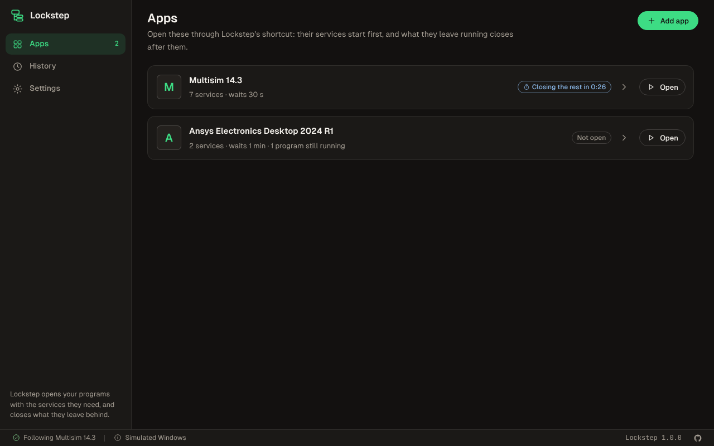
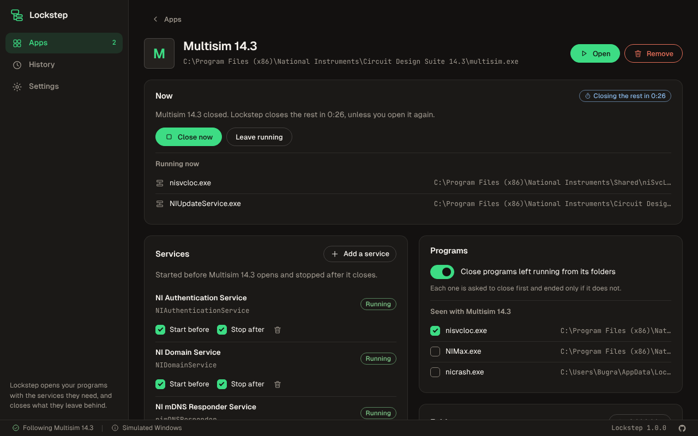
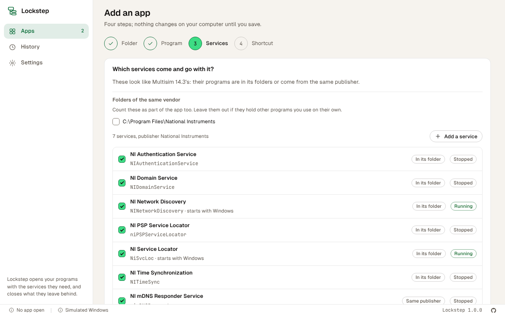
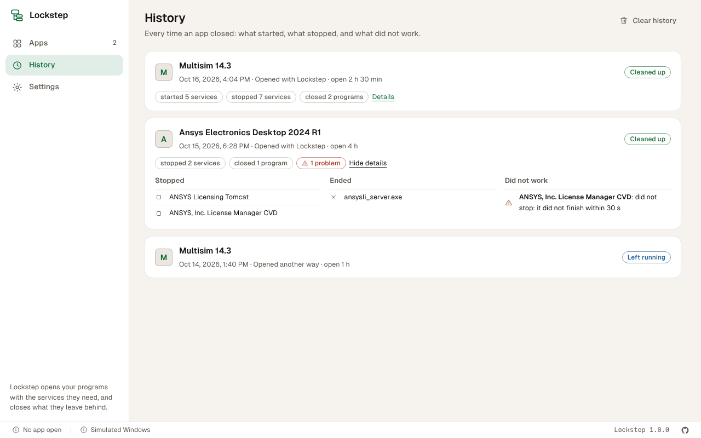

# Lockstep


Opens a program with the services it needs, and closes what it leaves behind.

Lockstep is a Windows app for programs that bring company: license servers, update services and
helpers that start with Windows and keep running long after the program is closed. Lockstep's
shortcut starts the program's services first, opens the program, and once it closes, stops the
services and closes the helpers it left running.

<br clear="left">

> **Not fully tested yet.** Version 1.0.0 is tested against a simulated Windows in the browser and,
> on GitHub's Windows runners, against a real one: real programs closed politely or ended, a real
> service started, stopped and given permissions, and the built app opened the way its shortcut
> opens it. It has not been used day to day with Ansys or Multisim yet.



## What it does

- **Works from a folder.** Choose the folder a program is installed in, then the program to open.
  Everything that runs from that folder, and every service whose program lives there, belongs to
  the app. Lockstep also suggests the services of the same publisher in other folders (license
  servers often sit apart from the program) and the vendor's folders elsewhere.
- **Starts what the program needs.** Its shortcut starts the chosen services, waits until they
  run, then opens the program. Services that start with Windows can be set to start only when
  needed.
- **Closes what it leaves.** After the program closes and a wait you choose (30 seconds by
  default), Lockstep asks each leftover program to close, gives it time, ends it if it does not,
  and stops the services, the ones that need others first. Opening the program again during the
  wait keeps everything running.
- **Asks Windows once.** Only administrators may start and stop services. Instead of running
  everything as administrator, Lockstep asks once, when an app is saved, to let your account start
  and stop those particular services. After that, opening and closing need no prompt.
- **Leaves alone what is not the app's.** Windows' own programs, programs of other people signed in,
  a service's process whose service the app does not stop, and anything another open app uses.
- **Keeps a history.** Each time an app closes: what started, what stopped, what was closed, what
  had to be ended and what did not work.
- English and Turkish, light and dark theme, on the Bugra design system.



## Download

From [Releases](https://github.com/bugragungoz/smart-launcher-scripts/releases): the `.exe`
installer (for your account) or the `.msi` (for every account). Windows 10 and 11, 64-bit.

## Use

1. **Add app**, then **Choose folder**: the program's own folder, for example
   `C:\Program Files (x86)\National Instruments` for Multisim or `C:\Program Files\AnsysEM` for
   Ansys Electronics Desktop. Lockstep refuses folders that hold unrelated programs, such as
   Program Files itself.
2. Pick the program to open; the likely one is first. Change the name if you like.
3. Check the services that come and go with it. The ones in its folders and from the same publisher
   are already checked.
4. Choose where the shortcut goes (the desktop by default; the program's own desktop shortcut can be
   put aside for it) and how long to wait after the program closes, then **Add app**. Windows asks
   once for administrator rights if the services need it.
5. Open the program from the new shortcut, and close it as usual.



**Watching apps opened another way.** A file, the Start menu or a taskbar pin opens a program
without Lockstep. With **Settings > Also watch apps opened another way**, Lockstep starts with
Windows, stays in the tray, notices those too and closes what they leave.

## The permission it asks for

A service's permissions are a list of entries saying who may do what. When an app is saved,
Lockstep (started once with administrator rights, after Windows asks you) adds one entry to each of
its services that lets **your account** query, start and stop that service, and nothing else. If
you choose to, it also sets services that start with Windows to start by hand.

Removing the app takes exactly that entry out again and restores how the services started, unless
another app still uses them. Everything else on the service stays as it was. The old scripts needed
"Run as administrator" on every launch, which also ran the program itself as administrator.

## Where things are kept

| What | Where |
|---|---|
| Apps and settings | `%APPDATA%\com.bugragungoz.lockstep\apps.json`, `settings.json` |
| History | `%LOCALAPPDATA%\com.bugragungoz.lockstep\history.json` (the last 300 sessions) |
| A program's own shortcuts Lockstep put aside | `%LOCALAPPDATA%\com.bugragungoz.lockstep\shortcuts\` (back in place when the app is removed) |
| Starting with Windows (only when watching apps opened another way) | `HKEY_CURRENT_USER\Software\Microsoft\Windows\CurrentVersion\Run`, value `Lockstep` |



## From the scripts

This repository held two batch scripts, `Ansys Electronics.bat` and `Multisim.bat`, that started a
fixed list of services, opened one program from a fixed path, and stopped the services when its
process ended. Lockstep does the same for any program without editing paths or service names, also
closes the helpers left behind, and needs administrator rights once instead of on every launch. The
scripts are in the history of this repository.

## Build it yourself

```bash
npm ci                    # the interface's packages
npm run dev               # the app, with the window reloading as you edit
npm run verify            # versions, translations, lint, colors, types and the interface's unit tests
cargo test --workspace    # the Rust core and the app's shell
npm run test:ui           # the built interface in Chromium against a simulated Windows
npm run shots             # the screenshots above
npm run build             # the installers (on Windows)
```

`cargo test --workspace -- --include-ignored` also runs the tests against the real system: they
create a test service, change the Run key and use this account's Lockstep folder (saved and put
back), so they need administrator rights. CI runs them on a Windows runner.

`npm run dev:web` runs the interface alone in a browser, against the simulated Windows of
`src/api/mock.ts`.

## License

[MIT](LICENSE)

Lockstep was built with the help of Claude, an AI model.
